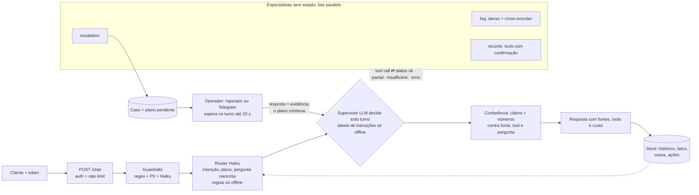

# Getnet Multi-Agent Support System

Atendimento multiagente para lojistas da Getnet: um Router decide entre o agente de conhecimento (RAG sobre o site oficial), o de suporte (ferramentas sobre os dados do cliente), o geral (clima e câmbio por API oficial, busca web) e o humano, em português ou inglês.

| | |
|---|---|
| Rodar | `docker compose up -d --build` → `http://localhost:8000/docs` · console do operador em `/operator` |
| Testar | `python scripts/check.py --docker --scale` (lint, testes, eval com gate, build, imagem sem extras, smoke do container, 2 réplicas atrás de balanceador) |
| CI | [GitHub Actions](../../actions/workflows/ci.yml) (o último commit é só o README; o código é o do commit anterior) |
| Vídeo | [walkthrough na página de Releases](../../releases/tag/video) (MP4 + legendas; narração por IA a partir do roteiro do autor, telas e números reais) |

O que o enunciado pede que o README cubra → onde: build, configure, run and test (§1) · orchestration architecture
(§2) · message workflow (§2.1) · RAG pipeline (§2.2) · design choices (§4) · how LLM tools were used (§5) · testing
strategy (§6).

## 0. Resultado em uma tela

O que o sistema entrega nos cenários do enunciado, medido ao vivo e gerado por `scripts/fill_readme.py` a partir de
`evals/results/` commitado (o `check.py` reprova divergência). As respostas reais de cada cenário oficial, com os
passos que o supervisor escolheu (agente, status, ferramentas, tempo), estão em [docs/DEMO.md](docs/DEMO.md); as
tabelas completas, em [docs/RESULTS.md](docs/RESULTS.md); o que veio do kit, em [docs/PROCEDENCIA.md](docs/PROCEDENCIA.md).

<!-- scorecard:begin -->
| medida | valor | como se mede |
|---|---:|---|
| Oficiais resolvidas (sem humano + todo fato + fonte) | 0.90 | resposta sem humano, com todo fato de referência do cenário e com fonte (os 10 do enunciado) |
| Oficiais resolvidas: pass^k (todas as rodadas) | 0.80 | o mesmo, em todas as rodadas de cada cenário |
| Juiz: respostas oficiais fundamentadas | 0.83 | juiz LLM com o texto das fontes: cada afirmação apoiada nelas |
| Juiz: respostas oficiais úteis (helpful) | 1.00 | juiz LLM: a resposta resolve o que o lojista perguntou |
| Memória ao vivo: pass@1 | 0.96 | conversas de vários turnos: o fato do turno anterior chega à resposta |
| Humano no laço: resposta do operador no mesmo turno (split hitl) | 1.00 | operadora simulada responde o caso aberto no turno dentro da espera: a resposta dela e os passos pendentes saem no mesmo turno (a que chega depois vai pela retomada, uma vez só) |
| Busca: Recall@3 | 0.85 | perguntas rotuladas olhando a fonte: a página certa entre as 3 primeiras |
| Busca: MRR | 0.81 | posição média da primeira página certa (1 = sempre em primeiro) |
| Turnos resolvidos sem humano (ao vivo, todos os splits) | 0.85 | todas as execuções ao vivo, de todos os splits: resposta sem pedir humano e sem erro (recusa do guardrail conta; o fato se confere só nas oficiais resolvidas) |
| Custo por turno resolvido sem humano (ao vivo) | US$ 0.0261 | gasto ao vivo de todos os splits (inclusive turnos que foram ao humano e turnos anteriores das conversas) ÷ as execuções resolvidas da linha acima |
<!-- scorecard:end -->

### 0.1 Mapeamento do desafio

| Requisito do enunciado | Implementação | Onde |
|---|---|---|
| Router Agent: entrada, decide o agente ou a sequência | router LLM (intenção, pergunta completa do turno, buscas) e supervisor LLM que observa cada resultado e decide o próximo passo | `src/app/router.py`, `src/app/supervisor.py` |
| Knowledge Agent: RAG sobre o site + busca web para o geral | busca densa + reranker nas páginas oficiais, resposta só com fonte citada; clima e câmbio por tool que o modelo escolhe ao lado da busca web (`currency_rate`: PTAX do Banco Central; `weather_forecast`: Open-Meteo), com entrada e valores conferidos no código (sem LLM, um detector por regex) | `src/app/rag.py`, `src/app/agents.py`, `src/app/live_data.py`, `data/` |
| Customer Support Agent com ≥ 2 tools | ferramentas sobre os dados do próprio cliente (identidade pelo token) | `src/app/domain/challenge/tools.py` |
| Comunicação entre agentes | especialistas como ferramentas do supervisor, passos registrados por turno | `src/app/supervisor.py` (`steps`) |
| `POST` com `{"message", "user_id"}` → JSON | `/chat` | `src/app/api.py` |
| Docker | `docker compose up -d --build` | `Dockerfile`, `docker-compose.yml` |
| Testes e estratégia de integração | §6 | `tests/`, `evals/`, `scripts/check.py` |
| Bônus: 4º agente humano | escalada com consulta ao operador dentro do turno e retomada do plano | `src/app/hitl_sync.py`, `src/app/resume.py` |
| Bônus: guardrails | entrada (injeção, dado de outro cliente, fora do escopo) e saída (número e frase sem base) | `src/app/guardrails.py`, `src/app/grounding.py` |
| Bônus: redirect/handoff | sem fonte ou sem dado → humano, com o motivo | `src/app/supervisor.py` |
| Bônus: avaliação e observabilidade | gabarito por cenário, juiz, traces, métricas e alertas | §6, `src/app/observability.py`, `ops/` |

### 0.2 Teste em 3 minutos

1. `docker compose up -d --build` e abra `http://localhost:8000/docs`.
2. Entre como o cliente de teste (§1, passo Entrar) e mande o 1º cenário oficial (o `curl` do §1).
3. Mande um seguimento curto ("e quanto custa?"): a resposta usa o turno anterior.
4. Pergunte algo que o site não cobre: o caso vai ao operador, que responde em `/operator`, e a conversa continua.

## 1. How to build, configure, run and test (construir, configurar, rodar e testar)

**Build e run** (sem chave roda no modo offline determinístico):

```bash
cp .env.example .env                      # opcional: chave e modelos; sem ele, offline
docker compose up -d --build              # build multi-stage + API em http://localhost:8000/docs
curl -s localhost:8000/health
```

**Entrar** (usuário e senha → o mesmo JWT de `/chat`; senhas de teste semeadas no próprio ambiente, só o hash fica
em `var/credentials.json`, fora do git):

```bash
docker compose exec api python -m app.auth seed-passwords   # imprime usuário e senha de cada cliente de teste
TOKEN=$(curl -s -X POST localhost:8000/auth/login -H "Content-Type: application/json" \
     -d '{"user_id": "<usuário>", "password": "<senha impressa acima>"}' | python -c 'import json,sys; print(json.load(sys.stdin)["access_token"])')
curl -s -X POST localhost:8000/auth/logout -H "Authorization: Bearer $TOKEN"   # sair: revoga o token
```

**Primeira conversa** (gerado por `scripts/fill_readme.py` a partir do 1º caso do split `official`):

<!-- quickstart:begin -->
```bash
# 1º caso oficial (official-01, evals/cases.jsonl), como o cliente cliente1988, com o $TOKEN do passo Entrar
# (atalho de teste, sem senha: TOKEN=$(docker compose exec -T api python -m app.auth cliente1988))
curl -s -X POST localhost:8000/chat -H "Authorization: Bearer $TOKEN" \
     -H "Content-Type: application/json" -d '{"message": "What'\''s the difference between the Get Clássica and the Get Smart?"}'
```
<!-- quickstart:end -->

**Testar:** `python scripts/check.py` (lint, testes, eval com gate, README ⇔ evidência) ·
`python scripts/check.py --docker --scale` (+ imagem, smoke do container, 2 réplicas atrás de balanceador) ·
`python -m evals.run_evals` (gate offline) · `python -m evals.run_evals --live --splits official,memory --judge
--max-usd 3` (ao vivo, com teto e juiz por split).

**Configurar:**

- **Identidade:** `AUTH_MODE=required` (só Bearer; padrão do compose) ou `demo` (aceita `user_id` do corpo, marca
  `identity_verified=false`, rate limit por IP), ligado só pelo override
  `docker compose -f docker-compose.yml -f docker-compose.demo.yml up` para o payload literal `{"message","user_id"}`.
  Decisão em [docs/adr/0001-auth-mode-demo.md](docs/adr/0001-auth-mode-demo.md). JWT com `kid` e chaves rotacionáveis
  (`AUTH_KEYS`: HS256, EdDSA, RS256; públicas em `GET /.well-known/jwks.json`; `python -m app.auth keygen`).
- **Vários hosts:** `DATABASE_URL=postgresql://...` troca o SQLite por Postgres atrás da mesma interface
  ([ADR 0003](docs/adr/0003-postgres-opcional.md)); `docker compose --profile postgres up -d --build postgres api-pg
  lb-pg` sobe 2 réplicas sem arquivo compartilhado; `scripts/pg_replicas_smoke.py` prova com 2 processos.
- **Operador humano:** `/operator` (token digitado na página, nunca embutido), `GET /handoffs`,
  `POST /handoffs/{id}/reply` com `X-Operator-Token`. A resposta vira o passo `human` e o plano segue na hora: no
  mesmo turno, dentro da espera, ou na retomada (§2.3). Fila por especialidade (`OPERATOR_SKILLS`,
  `PUT /operators/{nome}/skills`); SLA vencido re-roteia para qualquer operador. Ação com limite de valor
  (`RISK_POLICY` do domínio, `RISK_LIMITS`). Opcional: Telegram (`TELEGRAM_*` no `.env`) avisa o caso e aceita
  `/responder T-xxxx texto` pelo webhook `/telegram/webhook`.
- **Ao vivo:** `powershell -File scripts/live_eval.ps1 -MaxUsd 3` (eval por split com teto de US$,
  juiz e README). Extras opcionais fora da imagem: `.[hybrid]` (busca híbrida) e `.[otel]` (OpenTelemetry).

## 2. Orchestration architecture (arquitetura de orquestração)



Por que essa divisão: cada especialista tem uma fonte de verdade (faq → corpus, records → ferramentas, escalation →
fila humana) e devolve o mesmo contrato com status explícito (`AgentResult`); o supervisor só coordena, e o código
confere o que ele decide (`ALLOWED`, `MAX_STEPS`, orçamento, escalada garantida). A resposta do operador volta ao
plano como evidência, não como mensagem solta. Contrato público em `src/app/schemas.py`.
No desafio Getnet a divisão ganha a intenção `troubleshoot` (o suporte lê o terminal ou a transação e o achado `needs` chama o manual do conhecimento, sem o plano já trazer os dois) e a `general`, que nunca escala: clima e câmbio vêm das tools `weather_forecast` e `currency_rate`, com a data e a fonte da API. Taxonomia, desempates e tools congelados em [docs/SPEC.md](docs/SPEC.md) antes do código.

### 2.1 Message workflow (o caminho de uma mensagem)

1. `POST /chat` (`src/app/api.py`): identidade do token (nunca do corpo, salvo `AUTH_MODE=demo`) e rate limit.
2. Guardrails (`src/app/guardrails.py`): PII mascarada antes de qualquer log ou LLM; injeção barrada por regra e por
   Haiku; bloqueio responde na hora.
3. Memória (`src/app/memory.py`, `src/app/store.py`): histórico da conversa, resumo rolante, fatos já vistos e o
   perfil de longo prazo do usuário (fatos de outras conversas, como dado datado).
4. Router (`src/app/router.py`): intenção, plano de agentes e a pergunta reescrita completa (seguimento "e a outra?"
   vira pergunta autônoma) que a busca usa.
5. Supervisor (`src/app/supervisor.py`): roda o plano (independentes em paralelo), lê `ok` / `partial` /
   `insufficient` / `error` de cada agente e replaneja (outro agente ou humano).
6. Conferência (`src/app/grounding.py`, `src/app/claims.py`): todo número e toda frase da resposta contra fonte,
   ferramenta e pergunta; o que não tem base é reescrito, cortado ou escalado.
7. Resposta com fontes, ferramentas chamadas, handoff (ticket na fila do operador) e custo; o turno vai ao histórico.
   O texto não mostra código interno: o contrato do motor pede palavras e a limpeza final é a rede de segurança
   (citação com a oração inteira, nome de agente em palavras, valor de lista fechada pelo rótulo legível;
   `tests/test_r12_texto.py::test_citation_scrub_never_leaves_a_fragment`).
   No desafio, o passo 4 resolve também os seguimentos de terminal ("e a outra?", "how long has it been down?") como `support`, e o passo 5 encadeia suporte → conhecimento pelo achado da tool (terminal offline ou venda recusada).

### 2.2 RAG pipeline: ingestion → storage → retrieval → generation

- **Ingestion** (`src/app/ingest.py`): baixa as páginas de `data/sources.json` (só hosts permitidos), recorta texto
  visível em trechos literais de 300–800 caracteres; tabela inteira e rotulada; chrome do site e quase-duplicatas
  saem. Por padrão **sem corte na troca de seção e sem o contexto "título › seção" no índice**: medidos no gold da
  entrega anterior, os dois juntos tiraram Recall@3 de 0,82 para 0,747 (`INGEST_SECTION_CUT=on` e `RAG_CONTEXT=on`
  religam).
- **Storage**: trechos em JSONL versionado em `data/` (id, URL, `fetched_at`, sha256); vetores do denso em cache no
  disco.
<!-- retriever:begin -->
- **Retrieval** (`src/app/rag.py`; frase gerada de `KIT_RETRIEVER` por `scripts/fill_readme.py`): `dense+windows+cross:base`: denso `multilingual-e5-large` + cross-encoder `bge-reranker-v2-m3-int8` (top-10, 600 caracteres por trecho) — ordem do denso; nota do cross só no portão sem fonte: o redator lê os trechos na ordem do denso. Padrão do kit (`KIT_RETRIEVER` em `src/app/config.py`), sem medida no domínio: `run_evals --choose-retriever --apply` mede e grava `data/retriever.json`.
<!-- retriever:end -->
- **Busca no caminho do agente:** a 1ª busca usa as palavras do cliente e a pergunta reescrita pelo router entra
  junto; as buscas do plano rodam em paralelo (`FAQ_SEARCH_PARALLEL`) e, quando o plano gasta o teto, o redator
  ainda tem 1 busca corretiva. Placar no que o redator recebe: Recall@5 (o redator lê os 5 primeiros), MRR@10, rank
  do 1º trecho certo por pergunta e recorte por origem; separação com × sem fonte pela nota do cross-encoder, com a
  pergunta recusada pelo portão na conta (bloco de busca de `docs/RESULTS.md`). O portão "sem fonte" tem limiar
  calibrado (`--calibrate-rerank-gate`); o BM25 só entra no idioma do corpus (`rag.lexical_fits`).
- **Generation** (`src/app/agents.py`, `src/app/prompts/faq.md`): o agente de conhecimento redige só com os trechos
  aceitos e cita a fonte; responde o que a fonte cobre e diz o que falta (`partial`) ou vai ao humano (`insufficient`).
  Corpus do desafio: páginas de produto do site oficial (maquininhas e taxas, Pix, crediário, Link de Pagamento, pagamento pelo WhatsApp, Get Tap) e as FAQs da central `/duvidas/` (Get Smart, Get Conta, Pix, antecipação), listadas com URL, id e data em [docs/SOURCES.md](docs/SOURCES.md) e `data/sources.json`; a contagem de trechos sai da ingestão (`data/knowledge/`). O buscador é o padrão do kit, escolhido antes do relógio (não remedido aqui); o portão sem fonte é o do rerank, calibrado no gold deste domínio com pares pt/en.

### 2.3 Supervisão humana (o caminho do operador)

1. **Quando entra:** só quando o sistema não resolve ([ADR 0006](docs/adr/0006-humano-so-quando-nao-resolve.md)):
   nenhum especialista respondeu e faltou fonte, dado ou registro (`supervisor._enforce_escalation`), o cliente
   pediu, o orçamento do turno acabou (`budget_exhausted`) ou a ação passa do limite de valor. Resposta parcial só
   oferece o humano, sem abrir caso.
2. **Consulta no turno** (`src/app/hitl_sync.py`): o escalation abre o caso, avisa o operador (console `/operator`
   ou Telegram) e o turno espera a resposta por até `HITL_SYNC_WAIT_S` (20 s no `docker-compose.yml`, 0 na suíte;
   teto abaixo do timeout do balanceador; no máximo 8 esperas simultâneas). Respondeu no prazo → a resposta vira o
   passo `human` e volta ao supervisor LLM numa réplica do laço: o modelo roda os passos pendentes, pode chamar outro
   especialista com o que o operador disse (desvio `human-><agente>`, passo `decided_by: llm`) e redige a resposta
   final, que o código confere (protocolo citado, sem oferecer nem negar o atendente). Sem LLM, os pendentes rodam
   no motor de tabela e a resposta sai por template. Tudo **no mesmo turno**.
3. **Caso assíncrono** (`src/app/cases.py`, `src/app/resume.py`): fora do prazo, o caso fica na fila persistida
   com o plano pendente; mensagens novas do cliente entram no caso e nenhuma escrita é proposta enquanto ele está
   aberto. Quando o operador responde, a retomada leva a resposta à conversa como evidência e roda o resto do
   plano. Quem leva a resposta (turno ao vivo ou retomada) é decidido pelos carimbos gravados, sem corrida.
4. **Quatro olhos** (`src/app/actions.py`, `src/app/risk.py`): ação de risco alto precisa da confirmação do dono E
   da aprovação de um operador com chave pessoal (o token compartilhado não aprova); executa uma vez só, mesmo entre
   réplicas; pendente expira (TTL). O aviso da decisão sai no idioma da conversa e descreve a ação em palavras, sem o
   nome da tool.
5. **SLA e especialidade** (`src/app/routing.py`): fila por especialidade (`OPERATOR_SKILLS`); caso vencido é
   re-roteado uma vez para qualquer operador; cada resposta e aprovação fica na auditoria.

### 2.4 Estrutura do projeto

| Onde | O que é |
|---|---|
| `src/app/api.py` | API HTTP: `/chat`, login, operador, handoffs, LGPD, `/metrics`, `/analytics` |
| `src/app/pipeline.py` | um turno: guardrails → memória → router → supervisor → saída segura → persistência |
| `src/app/router.py`, `src/app/followup.py` | intenção, plano, idioma, confiança e a pergunta reescrita; seguimento elíptico |
| `src/app/supervisor.py` | executa o plano, lê o status de cada agente e replaneja (mapa do laço no topo do arquivo) |
| `src/app/agents.py` | especialistas faq, records e escalation, com status explícito |
| `src/app/rag.py`, `src/app/ingest.py` | busca (denso + cross-encoder) e ingestão de trechos literais |
| `src/app/grounding.py`, `src/app/claims.py` | conferência de números e de frases da resposta contra a evidência |
| `src/app/tools.py`, `src/app/actions.py`, `src/app/risk.py`, `src/app/capabilities.py` | ferramentas do domínio, confirmação do dono, aprovação do operador, limite de valor, cartão de capacidades |
| `src/app/hitl_sync.py`, `src/app/resume.py`, `src/app/cases.py`, `src/app/casestate.py`, `src/app/routing.py`, `src/app/notify.py` | supervisão humana: espera no turno, retomada do plano, caso, especialidade, Telegram |
| `src/app/memory.py`, `src/app/store.py`, `src/app/store_pg.py` | memória factual, estado persistido (SQLite; Postgres para vários hosts) |
| `src/app/auth.py`, `src/app/keys.py`, `src/app/guardrails.py` | identidade (JWT, JWKS, senha), limite de uso, guardrails |
| `src/app/llm.py`, `src/app/config.py` | provedores (offline, Anthropic, replay) e configuração por papel |
| `src/app/observability.py`, `src/app/analytics.py`, `src/app/candidates.py` | logs, métricas, custo, analytics e 👎 → candidato a caso de teste |
| `src/app/mcp_server.py`, `src/app/live_data.py`, `src/app/schemas.py`, `src/app/jsonl.py` | MCP em `/mcp`, dados ao vivo, contrato público, leitura de JSONL |
| `src/app/domain/` | **tudo o que muda por desafio**: `challenge/` é o produto desta entrega; `src/app/domain/example.py` é o domínio de teste do motor (os testes do kit rodam nele) |
| `src/app/prompts/` | instruções do domínio; `contract/` é o contrato do motor, anexado a cada uma |
| `data/` | corpus (trechos JSONL), registros de demonstração, exemplos de intenção |
| `evals/` | casos por split, eval offline e ao vivo, juiz, rótulos humanos, análise de erros |
| `tests/` | testes unitários e de integração (offline, sem chave) |
| `scripts/` | `check.py`, `fill_readme.py`, `scorecard.py`, bateria ao vivo, smoke de réplicas |
| `ops/`, `Dockerfile`, `docker-compose*.yml` | balanceador, Prometheus, alertas, Grafana; imagem e compose |
| `docs/` | ADRs, resultados, runbook, segurança (ASI), procedência |

### 2.5 Vocabulário de agentes → onde está no código

Os nomes dos padrões são os de Anthropic, [Building effective agents](https://www.anthropic.com/research/building-effective-agents)
(dez/2024), e de [12-factor agents](https://github.com/humanlayer/12-factor-agents) (HumanLayer); o código é deste
projeto.

| Padrão | O que é | Onde está |
|---|---|---|
| Augmented LLM | modelo com busca, ferramentas e memória | `src/app/rag.py`, `src/app/tools.py`, `src/app/memory.py` |
| Routing | classificar a entrada e mandar ao caminho especializado | `src/app/router.py` (intenção → plano de especialistas; regras e k-NN offline) |
| Orchestrator-workers | um orquestrador decide em tempo de execução que trabalhadores chamar e junta os resultados | `src/app/supervisor.py`: supervisor LLM com os especialistas como tools, em todo turno |
| Parallelization (sectioning) | partes independentes rodam ao mesmo tempo | `supervisor.run_batch`: passos independentes em threads, resultado na ordem do plano |
| Evaluator-optimizer | um avaliador confere a saída e ela é refeita | `src/app/grounding.py`, `src/app/claims.py`: número ou frase sem base é reescrito, cortado ou escalado; offline, o juiz (`evals/judge.py`) |
| 12-factor F6: launch, pause, resume | pausar o agente e retomar de onde parou | `src/app/cases.py`, `src/app/resume.py`: o plano pendente fica no caso e roda quando o humano responde |
| 12-factor F7: contact humans with tool calls | falar com o humano é uma tool como as outras | `escalation_agent` é tool do supervisor; `src/app/hitl_sync.py` espera a resposta no turno, e ela volta ao supervisor LLM como resultado do passo `human` |
| 12-factor F8: own your control flow | o código, não o modelo, controla o laço | `supervisor._enforce_escalation`, `ALLOWED`, `MAX_STEPS`, orçamento por turno: "o LLM propõe, o código dispõe" |
| 12-factor F12: stateless reducer | o agente é função de (estado, entrada) → saída; o estado mora fora | especialistas sem estado ([ADR 0007](docs/adr/0007-especialistas-sem-estado.md)): pergunta reescrita + livro de fatos → resultado; estado no `src/app/store.py` |

## 3. Cobertura da avaliação, por tema

Uma linha por tema: o mecanismo, o código, a prova principal e o limite. A tabela completa (todas as provas, o
número de cada tema e os limites inteiros) está em [docs/COBERTURA.md](docs/COBERTURA.md); todo caminho em crase das
duas existe (`tests/test_evidence.py` falha se um sumir).

| Tema | O que foi feito | Código | Prova principal | Limite |
|---|---|---|---|---|
| Business & Challenge Fit | os 10 cenários do enunciado, literais, no split `official` com os fatos de referência; o suporte lê o dado do cliente (`src/app/domain/challenge/tools.py`); KPI: perguntas resolvidas sem humano e com fonte (oficiais resolvidas, §0) | `src/app/tools.py` | `evals/cases.jsonl` | mede os cenários do enunciado e perguntas reais coletadas, não tráfego de produção |
| Agentic Reasoning & Orchestration | Supervisor LLM com os especialistas como tools: lê o status e todo achado das tools (`needs`) e decide cada passo; o código aprova (`ALLOWED`, `MAX_STEPS`, orçamento) e grava quem decidiu (`decided_by`) | `src/app/supervisor.py` | `tests/test_supervisor_needs_budget.py::test_llm_engine_gets_the_finding_the_rule_left_out_and_decides` | o modelo pode ignorar um achado mesmo após o lembrete (conta como `ignored`) |
| ↳ Router (faz parte de Agentic Reasoning & Orchestration) | Haiku com JSON schema: intenção, pergunta reescrita e buscas; reescrita com id inventado é recusada | `src/app/router.py` | `tests/test_r53_standalone.py::test_llm_rewrite_with_invented_id_is_rejected_and_falls_back_to_inheritance` | intenção fora dos exemplos do domínio cai no `DEFAULT_INTENT` |
| Context, Knowledge & RAG | Busca densa nas páginas oficiais com janelas por trecho (a melhor janela pontua o trecho quando casa claramente melhor; o redator recebe o trecho inteiro, com o mesmo id), com o cross-encoder só no portão sem fonte (padrão medido antes do relógio, `KIT_RETRIEVER`); o que a fonte não cobre sai `partial` ou `insufficient` | `src/app/rag.py`, `src/app/agents.py` | `tests/test_agents.py::test_faq_llm_not_in_sources_is_insufficient` | gold de busca escrito pelo time, não pelo cliente |
| Tool & Action Engineering | Schema validado no servidor e identidade do token (o `user_id` do modelo é descartado); escrita só com confirmação do dono e, no risco alto, aprovação de operador com chave pessoal (quatro olhos); executa uma vez só | `src/app/actions.py` | `tests/test_hitl.py::test_high_risk_action_needs_owner_then_operator_and_runs_once` | registros simulados (dados de demonstração) |
| Security & Identity | JWT via PyJWT (`kid`, JWKS, revogação); produção não sobe com `AUTH_MODE=demo` nem segredo fraco; rate limit e guardrail em 2 camadas falham fechado | `src/app/auth.py`, `src/app/guardrails.py` | `tests/test_api.py::test_production_refuses_demo_identity` | fora de produção, `AUTH_MODE=demo` aceita o `user_id` do corpo; no dev, token de operador compartilhado e `/metrics` sem token |
| Memory, State & Resilience | **Perfil de longo prazo por usuário** feito do livro de fatos, que entra numa conversa nova como dado datado, só para o dono; histórico com resumo rolante além da janela | `src/app/memory.py` | `tests/test_memory_ledger.py::test_fact_from_an_earlier_conversation_reaches_the_next_one_dated_and_as_data` | o perfil guarda fatos extraídos por código, não preferência dita em texto livre |
| Human Oversight & Risk Management | **O humano entra no laço**: a resposta do operador volta ao supervisor LLM como passo `human` e o plano segue no mesmo turno, até com outro especialista (`human-><agente>`) | `src/app/hitl_sync.py` | `tests/test_v54_hitl_sync.py::test_with_the_llm_the_operator_answer_returns_to_the_loop_and_feeds_a_step` | no eval a operadora é simulada (split `hitl`) |
| Evaluation & Quality Engineering | Manchete **oficiais resolvidas** (sem humano + todo fato + fonte); juiz LLM com canários; `expect.after_human` mede o plano depois do humano | `evals/run_evals.py`, `evals/judge.py` | `tests/test_e53_resolved.py::test_resolved_needs_no_handoff_every_fact_and_a_source`, `tests/test_r12_after_human.py::test_agent_after_the_answered_escalation_passes` | juiz da mesma família do modelo avaliado |
| Observability, Reliability & Cost | Log JSON com `trace_id`; US$ e tokens por request, com o **cache de prompt** na conta; `/metrics` com histograma de latência e **alertas Prometheus provisionados** | `src/app/observability.py`, `ops/alerts.yml` | `tests/test_r12_prompt_cache.py::test_cost_counts_the_cache_write_premium_and_the_cheap_read` | custo pela tabela de preços do kit, não pela fatura |
| Production Engineering | Imagem multi-stage não-root com base fixada por digest, lockfiles, smoke do container e **2 réplicas atrás de balanceador** no CI; overlay de produção endurecido | `Dockerfile`, `docker-compose.hardened.yml` | `tests/test_supply_chain.py::test_hardened_overlay` | com SQLite, réplicas só no mesmo host ([ADR 0002](docs/adr/0002-replicas-mesmo-host.md)) |
| Engineering Judgment | Cada decisão com a alternativa descartada e o número que decidiu; o considerado e não feito, com a medida | [`docs/adr/`](docs/adr/) | §4 e §9; prompts sem frase de caso de avaliação (`tests/test_router_contamination.py::test_domain_prompts_do_not_copy_eval_questions`) | neste corpus: portão do rerank × BM25 por idioma (commit `gate:`), gold essencial com 2 rotuladores cegos e o Jaccard entre eles (`evals/essential/report.json`) |

## 4. Design choices and trade-offs (decisões)

Cada decisão com a alternativa descartada e o número que a decidiu. Os números desta entrega estão no §0 e em
[docs/RESULTS.md](docs/RESULTS.md).

| Decisão | Alternativa descartada | Número que decidiu |
|---|---|---|
| **Supervisor LLM decide todo turno** (agentes como tools; [ADR 0005](docs/adr/0005-supervisor-em-todo-turno.md)) | atalho de 1 passo, em que a tabela escolhe o caminho dos casos mais comuns | a decisão fica observável em todo trace; custo: 2 chamadas e alguns segundos a mais por turno de um passo; sem chave ou com falha do provedor, a mesma tabela de transições roda offline |
| Busca **dense + cross-encoder** (e5-large + bge-reranker-v2-m3, top-10, 600 caracteres), **decidida por medida antes do relógio** ([ADR 0004](docs/adr/0004-buscador-denso-com-teto-de-ram.md)) | escolher o buscador no relógio (`--choose-retriever`) | no caminho do agente: Recall@3 0,868 · Recall@5 0,921 · MRR 0,789; no relógio de uma entrega anterior, a escolha com 8 subagentes na mesma CPU foi o caminho crítico e mediu latência errada (p95 2,9–3,5 s × 1,1–1,25 s com a máquina parada) |
| Híbrido BM25 + denso, pool 20 e trecho de 1000 caracteres **medidos e rejeitados** ([ADR 0008](docs/adr/0008-considerado-e-nao-feito.md)) | adotar a variante de maior Recall@3 | nenhuma ganha no top-5 que o redator lê sem custar latência: pool 20 0,842/0,921/0,776 com p95 6,1 s; 1000 caracteres 0,842/0,868/0,759; híbrido sem filtro de idioma tirou a fonte do official-04 nas 3 repetições (oficiais 96,7% → 90%) |
| **Humano só quando o sistema não resolve** ([ADR 0006](docs/adr/0006-humano-so-quando-nao-resolve.md)): resposta parcial oferece o humano; nada resolvido escala, garantido em código (`_enforce_escalation`) | deixar o LLM oferecer o humano em qualquer falta de fonte | a 1ª versão (falta de fonte vira oferta) derrubou o replan para 30%; com a regra em código: 95% |
| **Especialistas sem estado** ([ADR 0007](docs/adr/0007-especialistas-sem-estado.md)): só o router lê o histórico; o especialista recebe a pergunta reescrita e o livro de fatos | cada especialista relê 10 turnos crus | memória pass@1 0,72 → 92,7% pelo resultado, fatos 100%; dependent 95% → 100% |
| **Operador consultado no turno com espera curta** (`HITL_SYNC_WAIT_S`, teto 20 s, no máximo 8 esperas simultâneas) | o turno esperar o humano sem teto / só ticket assíncrono | o teto fica abaixo do timeout do balanceador (120 s, `ops/lb.py`) e do cliente; acima dele o caso segue assíncrono e a retomada leva a resposta à conversa |
| **Juiz com regra de validação fixada antes de medir** (≥ 10 por classe, TPR e TNR ≥ 0,8; senão roda só como regressão) | publicar a nota do juiz como verdade | a regra é aplicada ao gabarito de calibração desta entrega (`evals/results/judge.json`, `calibration.validation`); sem rótulo humano, o juiz conta só como regressão e o §0 diz isso |
| SQLite como padrão, **Postgres atrás da mesma interface** para vários hosts ([ADR 0003](docs/adr/0003-postgres-opcional.md)) | Postgres obrigatório / ORM / Redis | zero serviço externo para quem clona e roda; os testes de disputa (caso, ação, resposta, SLA, limite) rodam nos dois backends |
| Agentes independentes em threads | asyncio | os agentes fazem I/O síncrono (SQLite, SDK); threads cortam o p95 sem reescrever a pilha |
| Effort por papel (supervisor low, agentes medium) | um effort global | o supervisor só escolhe o próximo passo; quem redige com fonte precisa de mais |
| Portão "sem fonte" pela nota do rerank (`MIN_RERANK`) | portão BM25 (`MIN_SCORE`) calibrado no mesmo gold | o BM25 recusava a maioria das perguntas em inglês com fonte (tabela por idioma de `run_evals --calibrate-gate`); o do rerank separou com × sem fonte nos dois idiomas (`--calibrate-rerank-gate`, commit `gate:`) |

## 5. How LLM tools were used (como as ferramentas de LLM foram usadas)

- **No produto:** papéis com modelo e effort próprios (`src/app/config.py`): router e guardrail Haiku, supervisor e
  agentes Sonnet, juiz Opus ou de outra família (`JUDGE_PROVIDER=openai_compat`). Ferramentas com JSON Schema e
  identidade do servidor (`src/app/tools.py`); saída estruturada no router e no juiz; cache de prompt no system e
  nas tools de cada papel; cassete grava cada resposta do LLM para o replay offline no CI.
- **Na construção:** uma sessão principal escreveu a SPEC, os casos oficiais e de orquestração, integrou e mediu; subagentes em worktrees próprios fizeram o corpus e o gold (conhecimento), o roteamento e os prompts, as tools e o CRM, os casos de qualidade e segurança e a documentação; dois autores cegos escreveram o held-out, um terceiro coletou as perguntas reais com link, e dois rotuladores cegos marcaram as passagens essenciais do gold de busca; uma sessão de fora do relógio acompanhou e revisou; o motor, o runner de avaliação, os scripts e a CI vieram do kit; o domínio (corpus, glossário, taxonomia, prompts do domínio, tools, CRM, casos, gold) foi escrito no relógio; detalhe em [docs/PROCEDENCIA.md](docs/PROCEDENCIA.md).
- **Na avaliação:** LLM como juiz com canários e um gabarito de calibração (rótulos escritos a partir da SPEC; humanos
  quando houver rotulagem); rascunho de rótulo pelo modelo com revisão do dono linha a linha
  (`python -m evals.error_analysis`), separado da rotulagem cega.

## 6. Testing strategy (unit, integration, live)

**Avaliação: o que medimos e como.** Cada cenário do enunciado vira um caso no gabarito (`evals/cases.jsonl`) com a
mensagem literal, a intenção, os agentes e ferramentas esperados, os fatos de referência (regex escrita antes do
código, a partir da fonte) e se o caso deve ou não ir ao humano. Três camadas: (1) busca, contra perguntas rotuladas
olhando a página certa (Recall@k, MRR); (2) ponta a ponta offline, determinística, no CI a cada commit; (3) ao vivo,
com o modelo real, repetida por cenário (pass^k) e julgada por um juiz LLM que lê o texto das fontes. Uma resposta só
conta como **resolvida** sem humano, com todo fato de referência e com fonte.

- **Unit** (`python -m pytest`): offline e determinístico, sem rede nem chave; banco por teste; cada correção com o
  teste que a prova (§3).
- **Integration**: gate offline do eval (`python -m evals.run_evals`, banco por caso) e README ⇔ evidência no
  `scripts/check.py`; com `--docker`, imagem, smoke do container (com e sem rede), eval via HTTP e 2 réplicas.
- **Live** (`--live`): por split com teto de US$ proporcional ao tamanho, `--repeat` (pass^k), manchete **oficiais
  resolvidas** (sem humano + todo fato de referência + fonte), juiz no mesmo processo depois de cada split,
  cassete para o replay no CI (`--replay`, piso = taxas da gravação aceita).
- **Humano**: análise de erros em ~60 traces reais (rascunho do modelo, edições do dono contadas, um modo de falha
  por checagem) e held-out cego rotulado na página (passa/falha ponta a ponta; a intenção é diagnóstico).
  No relógio rodaram a fumaça ao vivo dos oficiais, a bateria ao vivo integral com o juiz e o check; a rotulagem humana NÃO rodou neste ensaio (decisão do dono: nenhum rotulador), então o juiz conta só como regressão e a análise de erros sai como rascunho não revisado.

## 7. Perguntas da entrevista, respondidas

As perguntas que uma entrevista técnica faria, respondidas com o número medido nesta entrega (prova que não existir nesta entrega sai da tabela).

| Pergunta | Resposta curta | Onde está a prova |
|---|---|---|
| Quais respostas oficiais o juiz reprova, e por quê, se intenção e ferramentas acertam? | official-04 (Pix sem conta bancária): a busca do caminho do agente trouxe só trechos de Pix, sem o da Get Conta que está no corpus e no top-5 da busca direta (`official_check`); official-01: numa repetição o redator leu a linha errada da tabela de aluguel. Sem rodada 2 no relógio: não há "depois" medido (JUDGE_DIFF não medido) | `docs/JUDGE_DIFF.md` |
| O rerank tem ganho medido? Por que está (ou não) no caminho? | não remedido no relógio: o buscador é o padrão do kit, escolhido antes por medida fora daqui; o rerank decide só o portão sem fonte, calibrado neste domínio (commit `gate:`); `make compare` refaz a tabela | `evals/results/retrieval_compare.json` |
| Onde a memória perde informação? | o split `memory` mede o fato lembrado (`expects_fact`) separado da intenção; os números e as falhas estão no §0 e em `docs/RESULTS.md` | §0 e `docs/RESULTS.md` |
| Quanto do kit foi escrito depois das correções anteriores? | o motor inteiro veio do kit; o domínio inteiro foi escrito no relógio (ver `git log` desde o commit de scaffold e [docs/PROCEDENCIA.md](docs/PROCEDENCIA.md)) | `docs/PROCEDENCIA.md` |
| Como medir o ganho do replanejamento em perguntas reais? | o split `real` (40 perguntas públicas com link) rodou ao vivo com o achado `needs`; o braço sem (`--ablate-replan --mode no_needs --split real`) não rodou no relógio, então o ganho não está medido | `evals/results/ablation_replan*.json` |

## 8. Procedência e linha do tempo

O primeiro commit traz um kit próprio, que **evoluiu a partir das correções das entregas anteriores deste desafio**
(histórico por versão em [docs/KIT_CHANGELOG.md](docs/KIT_CHANGELOG.md)). O relógio mede a especialização para este
enunciado, não o esforço do motor genérico: [docs/PROCEDENCIA.md](docs/PROCEDENCIA.md) explica o que cada parte mede
e como comparar pela primeira entrega.
`src/app/domain/example.py` é o domínio de teste do motor (os testes do kit rodam nele); o produto desta entrega é
`src/app/domain/challenge/`.

<details><summary>Linha do tempo (git log)</summary>

<!-- timeline:begin -->
| hora (UTC; Brasília = UTC−3) | min | commit |
|---|---:|---|
| 10:55:10 | 0 | chore: repositório (antes do relógio) |
| 11:07:45 | 13 | chore: scaffold from entregar-desafio-cronometrado kit v5.4.0 |
| 11:10:26 | 15 | spec: oficiais (10 cenários com fatos e entidades) |
| 11:13:19 | 18 | spec: taxonomia, desempates, parcial, standalone, tools + 58 casos (replan 20, dependent 10, memory 16, hitl 6, parallel 3, approval 3) |
| 11:13:46 | 19 | spec: taxonomia, desempates, parcial, standalone, tools + 58 casos (replan 20, dependent 10, memory 16, hitl 6, parallel 3, approval 3) |
| 11:17:15 | 22 | evals: split real (40) entra nos casos, fora do gate |
| 11:21:25 | 26 | evals: fumaça ao vivo official repeat 1 (US$ 0,16; sha 2909340, antes do router do domínio: 10/10 em faq, 2 escalaram clima/câmbio) |
| 11:48:01 | 53 | evals: rodada 1 ao vivo, 13 splits complete com juiz (official/memory repeat 3) + FAILURE_MODES (análise de erros não revisada) |
| 11:51:57 | 57 | evals: juiz retomado só no que faltou (--resume, US$ 0,34): status ran; FAILURE_MODES e DEMO regerados |
| 11:52:21 | 57 | docs: mensagem de entrega (rascunho do T+44) |

Do primeiro ao último commit: **57 min**, 52 commits (aqui os 10 marcos; todos em `docs/TIMESHEET.md`).
<!-- timeline:end -->

</details>

## 9. Limitações e próximos passos

Cada limitação com o efeito que ela tem e o que faltaria para resolver:

- Simulado: o CRM (`data/crm/`, dois clientes com datas relativas a hoje) e a operadora humana nos testes de HITL (`evals/operator_sim.py`). Efeito: as respostas de suporte provam o caminho (tool → total calculado no código → resposta), não a integração com o sistema real da Getnet; faltaria o conector do backoffice com o mesmo schema e a fila ligada ao time de atendimento.
- Cada medida do §0 abaixo da referência ou não medida tem o número no próprio §0 (gerado). Mecanismos conhecidos: official-04 perde a Get Conta na busca do agente (corrigir: glossário/consulta do plano e regravar o split official, ~US$ 0,6); official-01 lê a tabela de aluguel fora de alinhamento numa repetição (corrigir: ingerir a tabela linha a linha); o guardrail offline é só a camada de regex do motor e não barra parte dos ataques escritos à mão (o número que vale é o ao vivo, no §0); concordância humana não medida (ensaio sem rotulador por decisão do dono; na produção, 2 rotuladores); análise de erros não revisada (0 linhas revisadas pelo dono).
- Cortes do relógio (§2.1 do roteiro): rodada 2 não medida (JUDGE_DIFF "não medido"); sem vídeo; ablação do replanejamento nas perguntas reais não rodou; `check.py --docker --scale` não reconferido no relógio (o Docker Hub devolveu 429 no aquecimento da imagem); o gate offline completo (`make eval`) foi interrompido para a bateria ao vivo começar; factual sem validação humana — ensaio sem rotulador por decisão do dono (na produção, 2 rotuladores).
