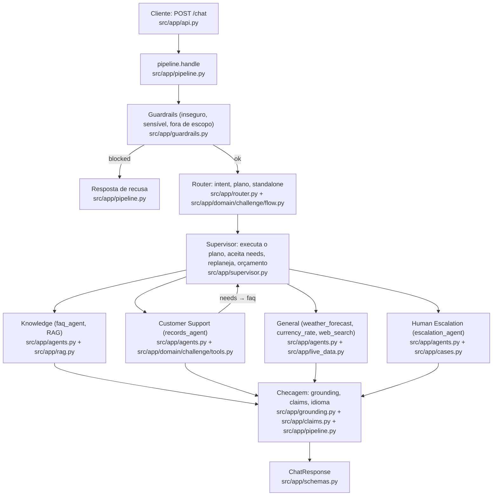
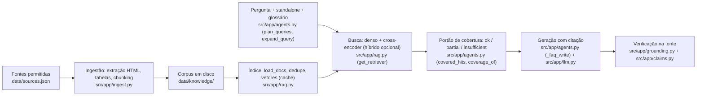
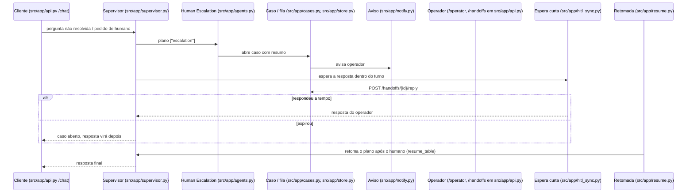

# Arquitetura

Descreve só o que o código faz. Cada caixa traz o arquivo. O domínio (`src/app/domain/challenge/`) segue a
[SPEC](SPEC.md): taxonomia de intents e tools com nomes congelados.

## 1. Agentes

- O Router é o único leitor do histórico; os especialistas recebem a pergunta reescrita (`standalone`)
  ([ADR 0007](adr/0007-especialistas-sem-estado.md)).
- O Supervisor roda em todo turno ([ADR 0005](adr/0005-supervisor-em-todo-turno.md)) com teto de chamadas, custo e
  tempo por nó (`max_model_calls`, `max_turn_usd`, `node_timeout_s` em `src/app/supervisor.py`).
- `general` nunca escala (`no_escalation` em `src/app/supervisor.py`).
- Escritas (`open_support_ticket`, `request_receivables_advance`) passam por confirmação e aprovação em
  `src/app/actions.py` (`/actions/{id}/confirm|approve|reject` em `src/app/api.py`).

Taxonomia (SPEC): `knowledge` → `["faq"]`; `support` → `["records"]`; `troubleshoot` → `["records"]` + `needs` → faq;
`general` → `["general"]`; `multi` → `["faq","records"]`; `human_request` → `["escalation"]`; `blocked` → guardrail.

## 2. RAG

Escolha do buscador: [ADR 0004](adr/0004-buscador-denso-com-teto-de-ram.md); o que foi medido e ficou de fora:
[ADR 0008](adr/0008-considerado-e-nao-feito.md).

## 3. HITL (humano no laço)

Quando escalar: só quando não resolve ([ADR 0006](adr/0006-humano-so-quando-nao-resolve.md)). SLA dos casos:
`POST /handoffs/sla-check` em `src/app/api.py`.
